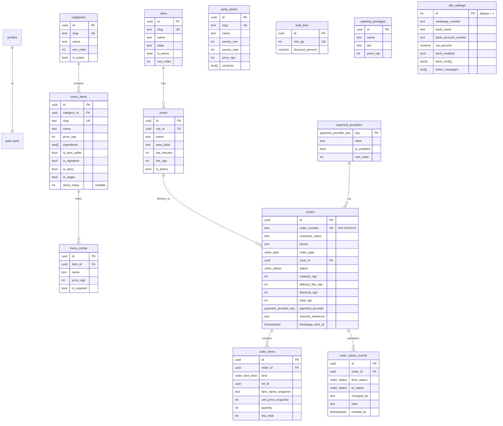

# Schema

Every table, every column, every RLS policy. Source of truth is `supabase/migrations/001_init.sql` … `005_seed.sql`. This file is the human-readable companion.

## ERD

## Enums

| Name | Values |
| --- | --- |
| `order_type` | `pickup`, `delivery` |
| `order_status` | `pending`, `awaiting_payment`, `paid`, `confirmed`, `preparing`, `ready`, `out_for_delivery`, `delivered`, `completed`, `cancelled` |
| `payment_provider_key` | `monnify_card`, `monnify_transfer`, `manual_bank` |
| `order_item_kind` | `menu_item`, `party_pack` |

## Table notes

### `profiles`
One row per `auth.users`. Holds `is_admin` (the sole gate for `/admin`). No public signup — rows are created when a user is invited from the Supabase dashboard.

### `cities` and `zones`
Multi-city architecture. Only cities with `is_active = true` show in the checkout. Zones belong to exactly one city. Zones are only selectable when their parent city is active.

### `menu_items`
- Prices are stored as integers in **kobo** equivalent — i.e. `price_ngn` = whole Naira (never kobo fractions).
- `ingredients` is `text[]`, one entry per ingredient — used for the JSON-LD `MenuSection` and the item-page chips.
- `stock_today` is `NULL` for unlimited; when set, the UI grays out the add-to-cart at zero.
- Full-text search: `menu_items_search_idx` is a GIN index over `to_tsvector('simple', name || ' ' || description)`.

### `menu_extras`
Per-item add-ons ("+ Extra chicken — ₦800"). `is_required` forces at least one selection (used for e.g. a choose-your-soup category).

### `party_packs`
Independent of menu items. `contents` is a `text[]` listing what's inside; rendered on the card and in the item detail.

### `bulk_tiers`
Per-line discount. Seeded tiers: 6→10%, 12→20%, 24→30%, 50→46.4% (the last matches Rahmies' "up to 46.4%").

### `payment_providers`
Primary key is the enum value. Only three rows ever exist. Admin can toggle `is_enabled` and reorder with `sort_order`.

### `site_settings`
Single row with `id = 1` (CHECK enforced). Holds bank account details, ticker array, VAT %, dock config. Never exposed publicly via SELECT — a `view_bank()` RPC is the sole public path to the three bank fields.

### `orders`
- `order_number` is `TEXT UNIQUE`, format `KW-` + 6 base36 chars.
- Money fields snapshot at submit; later menu-price changes don't rewrite history.
- `whatsapp_sent_at` is set by `/api/monnify/webhook` when a paid event fires — the `/track` page auto-opens the WhatsApp handoff only once (null → set).
- Free-text `notes` field for the customer's order note.

### `order_items`
`item_name_snapshot` and `unit_price_snapshot` are stored at submit time. Deleting a menu item never breaks a historical order.

### `order_status_events`
Written on every transition (customer submit, Monnify webhook, admin status change, admin cancel). `changed_by` is either `'customer'`, `'monnify'` or the admin email.

## RLS policies (see `003_rls.sql`)

Every table has row-level security enabled. Semantics:

| Table | Public (anon) | Authenticated non-admin | Admin (`profiles.is_admin`) | Service role |
| --- | --- | --- | --- | --- |
| `cities`, `zones`, `categories`, `menu_items`, `menu_extras`, `party_packs`, `catering_packages`, `bulk_tiers`, `payment_providers` | SELECT where `is_active = true` | same | SELECT/INSERT/UPDATE/DELETE everywhere | same |
| `site_settings` | Only via `view_bank()` when `manual_bank` is enabled | same | Full CRUD | same |
| `orders` | INSERT with `status IN ('pending','awaiting_payment')` only | same | Full CRUD | Full CRUD |
| `order_items`, `order_status_events` | No direct access | No direct access | Full CRUD | Full CRUD |
| `profiles` | None | SELECT own row | Full CRUD | Full CRUD |

The service-role key bypasses RLS entirely; it's only ever used server-side (Monnify webhook, bootstrap admin actions).

## Storage buckets (see `004_storage.sql`)

| Bucket | Public? | Path pattern | Who writes |
| --- | --- | --- | --- |
| `menu-images` | Yes (read) | `<item_or_pack_id>/<filename>` | Admin via signed URL from `/api/uploads` |
| `party-pack-images` | Yes (read) | same | Admin |
| `catering-images` | Yes (read) | same | Admin |

Signed URLs are 60-second, single-use, capped at 5 MB, content-type restricted to `image/{jpeg,png,webp}`.
